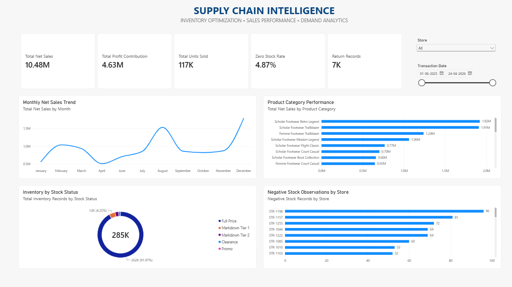
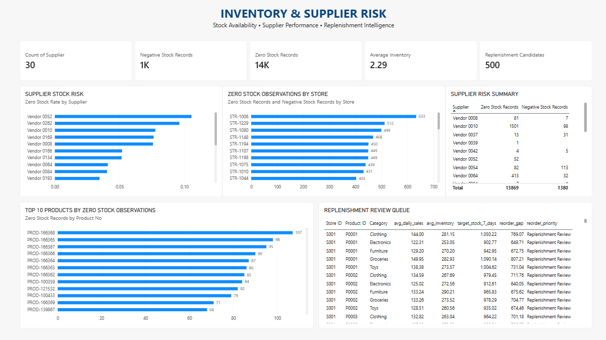

# Supply Chain Intelligence & Inventory Optimization

An end-to-end retail analytics project combining Python, MySQL, machine learning, and Power BI to investigate inventory health, sales performance, supplier risk, and replenishment planning.

## Project Overview

Retail businesses need to balance product availability, inventory costs, and customer demand. Limited inventory visibility can result in stock shortages, excess stock, and inefficient replenishment decisions.

This project analyses retail inventory, sales, and demand datasets to identify operational risks, understand product performance, examine supplier-level inventory patterns, and generate data-driven replenishment review recommendations.

The project follows an end-to-end analytics workflow, from raw data exploration and database development to machine learning experimentation and interactive business intelligence reporting.

## Business Objectives

- Analyse historical retail inventory and sales performance.
- Identify products and stores with recurring zero-stock and negative-stock observations.
- Perform ABC product classification based on net sales contribution.
- Examine supplier-level inventory risk patterns.
- Develop and evaluate a baseline demand forecasting model.
- Generate illustrative inventory replenishment recommendations.
- Build interactive Power BI dashboards to communicate business insights.

## Technology Stack

| Area | Tools |
|---|---|
| Programming | Python |
| Data Analysis | Pandas, NumPy |
| Database | MySQL |
| Database Connectivity | SQLAlchemy, PyMySQL |
| Machine Learning | Scikit-learn |
| Visualisation | Matplotlib, Seaborn |
| Business Intelligence | Power BI |
| Development | Jupyter Notebook, VS Code |

## Project Architecture

```text
Raw Datasets
     |
     v
Data Exploration & Quality Checks
     |
     v
Data Cleaning & Transformation
     |
     v
MySQL Database
     |
     v
Exploratory & Business Analysis
     |
     v
Demand Forecasting
     |
     v
Inventory Planning Recommendations
     |
     v
Power BI Executive Dashboard
```

## Dataset Overview

The project uses multiple retail datasets:

| Dataset | Records | Purpose |
|---|---:|---|
| Retail Inventory | 284,755 | Inventory health and stock analysis |
| Retail Sales | 125,751 | Sales and contribution analysis |
| Retail Demand | 73,100 | Demand analysis and forecasting |
| Product Catalogue | 27,555 | Product catalogue exploration |

The three primary retail datasets contain 483,606 records in total.

The product catalogue is a separate dataset and was not directly joined to the retail transactional datasets.

## Project Workflow

### 1. Data Exploration and Preparation

Explored and prepared the retail inventory, sales, demand, and product catalogue datasets.

Data quality checks included:

- Missing values and duplicate records.
- Negative and zero inventory quantities.
- Negative unit costs and zero selling prices.
- Negative demand forecasts.
- Sales returns and unusual transaction values.
- Data consistency and validation checks.

Unusual records were retained where appropriate, with validation flags and cleaned analytical fields added rather than silently removing potentially meaningful observations.

Processed datasets were saved separately for subsequent analysis.

### 2. Database Design — MySQL

Created a MySQL database named `freshcart_analytics`.

The database includes:

**Dimension tables**
- `dim_product`
- `dim_store`
- `dim_supplier`
- `dim_date`

**Fact tables**
- `fact_inventory`
- `fact_sales`
- `fact_demand`

**Staging tables**
- `stg_inventory`
- `stg_sales`
- `stg_demand`

The database workflow includes staging, dimension loading, fact-table population, and data validation.

The demand dataset uses a separate product and store identifier system. It was therefore analysed independently instead of joining records based only on matching-looking IDs.

### 3. Inventory and Sales Analysis

The business analysis focused on:

- Inventory stock-status distribution.
- Zero-stock and negative-stock observations.
- Store-level inventory risk.
- Sales and profit contribution analysis.
- ABC product classification based on cumulative net sales.
- Supplier-level zero-stock patterns.
- High-risk product and supplier combinations.

### 4. Demand Forecasting

A Random Forest regression model was developed to estimate units sold.

The model used a chronological training and testing split to preserve time order.

**Baseline model evaluation**

| Metric | Result |
|---|---:|
| MAE | 88.96 |
| RMSE | 108.38 |
| R² | -0.0027 |

A second version incorporating lag-based features was also evaluated. It did not improve the baseline results.

The baseline model was retained as an experimental benchmark.

The negative R² indicates that the model did not outperform a simple mean-based prediction benchmark on the test set. The forecasting component therefore demonstrates model development and evaluation rather than production-ready predictive accuracy.

### 5. Inventory Planning Recommendations

An illustrative seven-day stock coverage target was calculated using average cleaned demand forecasts.

The analysis generated 500 store-product-category planning records and identified replenishment review candidates.

The output is saved as:

`reports/inventory_recommendations.csv`

The recommendations compare historical average inventory against an illustrative seven-day target. They are intended for planning review and are not live purchase orders, optimised reorder points, or safety-stock calculations.

## Key Business Findings

- Analysed 284,755 inventory observations across 2,326 products, 40 stores, and 30 suppliers.
- Identified 13,869 zero-stock records and 1,380 negative-stock records.
- ABC classification identified 928 A-class products contributing approximately 79.99% of net sales.
- Vendor 0169 showed a 7.62% historical zero-stock rate, compared with a 4.89% weighted benchmark across the selected suppliers.
- Generated 500 store-product-category replenishment planning combinations.
- The forecasting experiment highlighted the limitations of the available predictive features.

These findings describe the supplied historical datasets and should not be interpreted as current operational conditions.

## Power BI Dashboard

The Power BI report contains two interactive pages.

### 1. Executive Overview

- Net Sales and Profit Contribution.
- Units Sold and Return Records.
- Zero Stock Rate.
- Net Sales Trend.
- Product/Category Performance.
- Inventory Distribution by Stock Status.
- Negative Stock Observations by Store.

**Dashboard Preview**



### 2. Inventory & Supplier Risk

- Supplier Zero Stock Rate.
- Supplier Risk Summary.
- Top 10 Products by Zero-Stock Observations.
- Store Inventory Risk.
- Replenishment Review Queue.

**Dashboard Preview**



**Power BI file:**

`dashboard/Mission_01_Supply_Chain_Intelligence.pbix`

## Repository Structure

```text
Supply-Chain-Intelligence/
│
├── data/
│   ├── raw/
│   └── processed/
│
├── notebooks/
│   ├── 01_data_exploration.ipynb
│   ├── 03_mysql_database_setup.ipynb
│   └── 04_demand_forecasting.ipynb
│
├── sql/
│   ├── 01_create_database_and_staging.sql
│   ├── 02_create_and_populate_dimensions.sql
│   ├── 03_create_and_populate_fact_tables.sql
│   ├── 04_data_quality_and_validation.sql
│   └── 05_business_analysis.sql
│
├── reports/
│   ├── data_quality_report.csv
│   └── inventory_recommendations.csv
│
├── dashboard/
│   └── Mission_01_Supply_Chain_Intelligence.pbix
│
├── screenshots/
│   ├── executive_overview.png
│   └── inventory_supplier_risk.png
│
├── README.md
└── requirements.txt
```

## Limitations

- The forecasting model has limited predictive performance and is not production-ready.
- Historical zero-stock observations do not establish actual lost sales.
- Supplier-level zero-stock patterns do not establish supplier delivery failures.
- Replenishment recommendations use historical averages rather than real-time inventory.
- The datasets have different identifier systems and are not all directly joinable.
- Profit contribution is a dataset metric and should not be interpreted as fully audited net profit.
- ABC classification is based on net sales, not profitability or demand variability.

## Future Improvements

- Improve demand forecasting with richer time-series features.
- Evaluate alternative forecasting algorithms.
- Incorporate supplier lead times and purchase order information.
- Introduce safety-stock and reorder-point calculations.
- Develop automated inventory risk alerts.
- Extend the dashboard with more detailed product and supplier performance analysis.
- Deploy the analytical solution as an interactive application.

## Conclusion

Supply Chain Intelligence & Inventory Optimization demonstrates an end-to-end analytical workflow, combining data preparation, relational database design, exploratory analysis, machine learning experimentation, inventory planning, and business intelligence reporting.

The objective is to transform historical retail data into meaningful operational insights while maintaining transparency about model performance and analytical limitations.